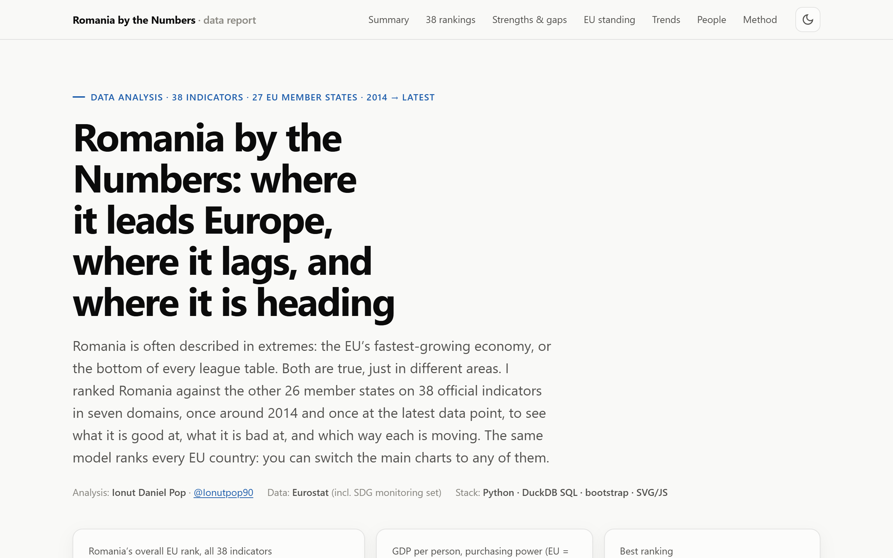
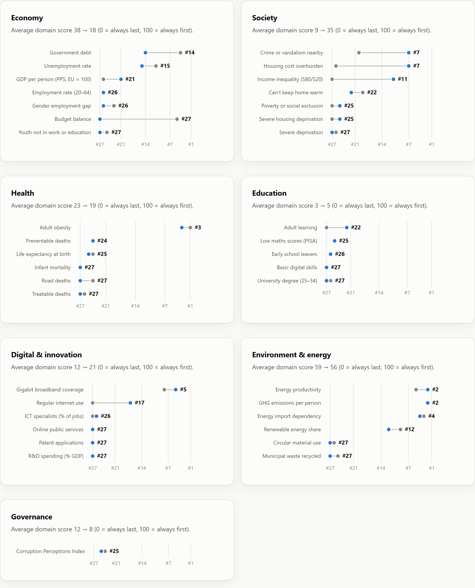
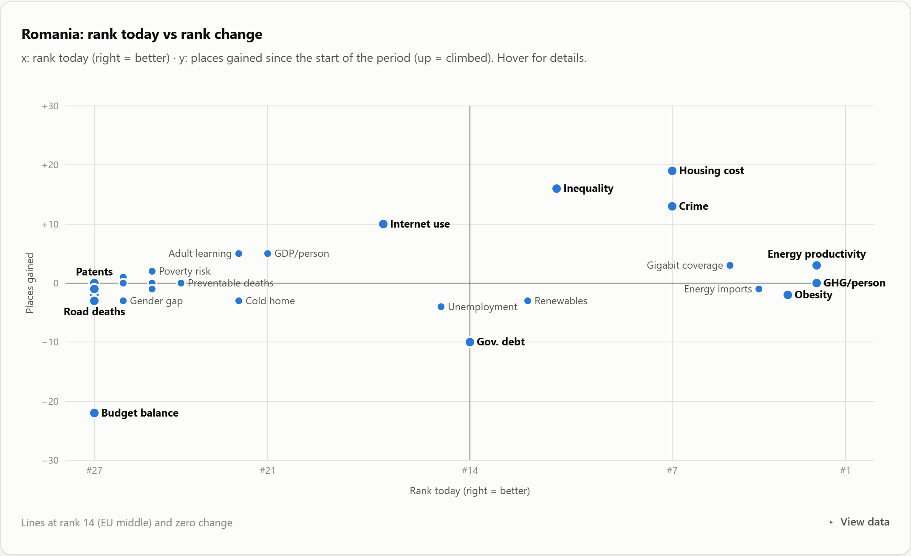
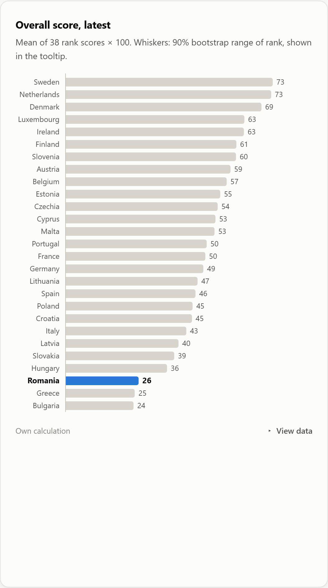
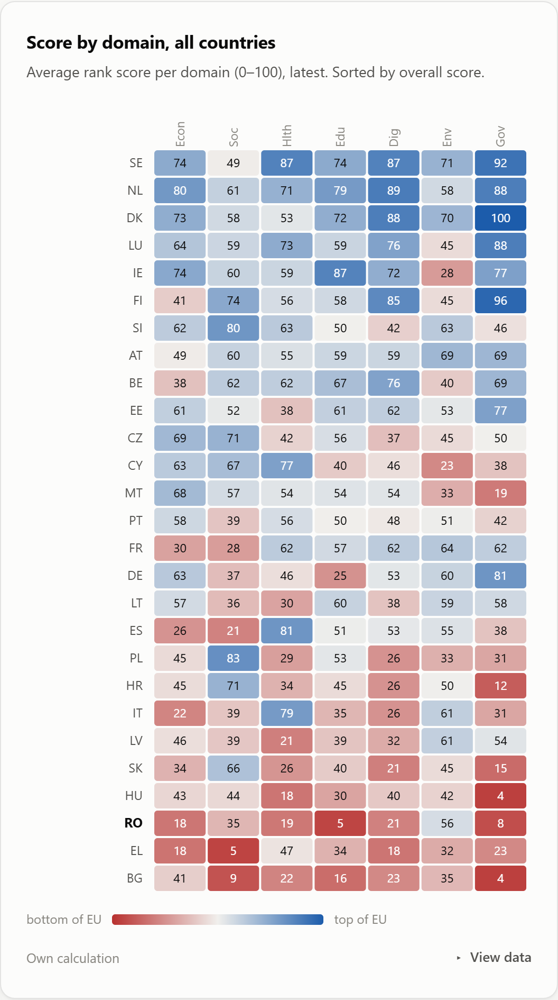
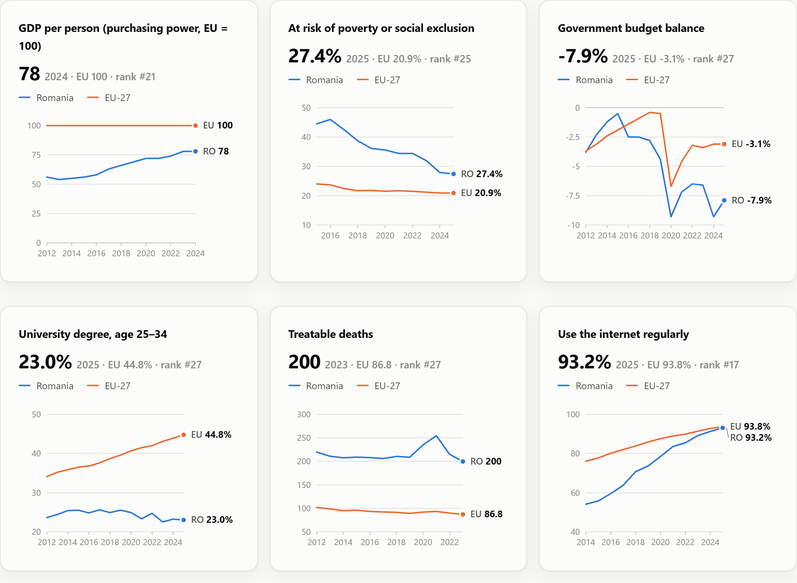
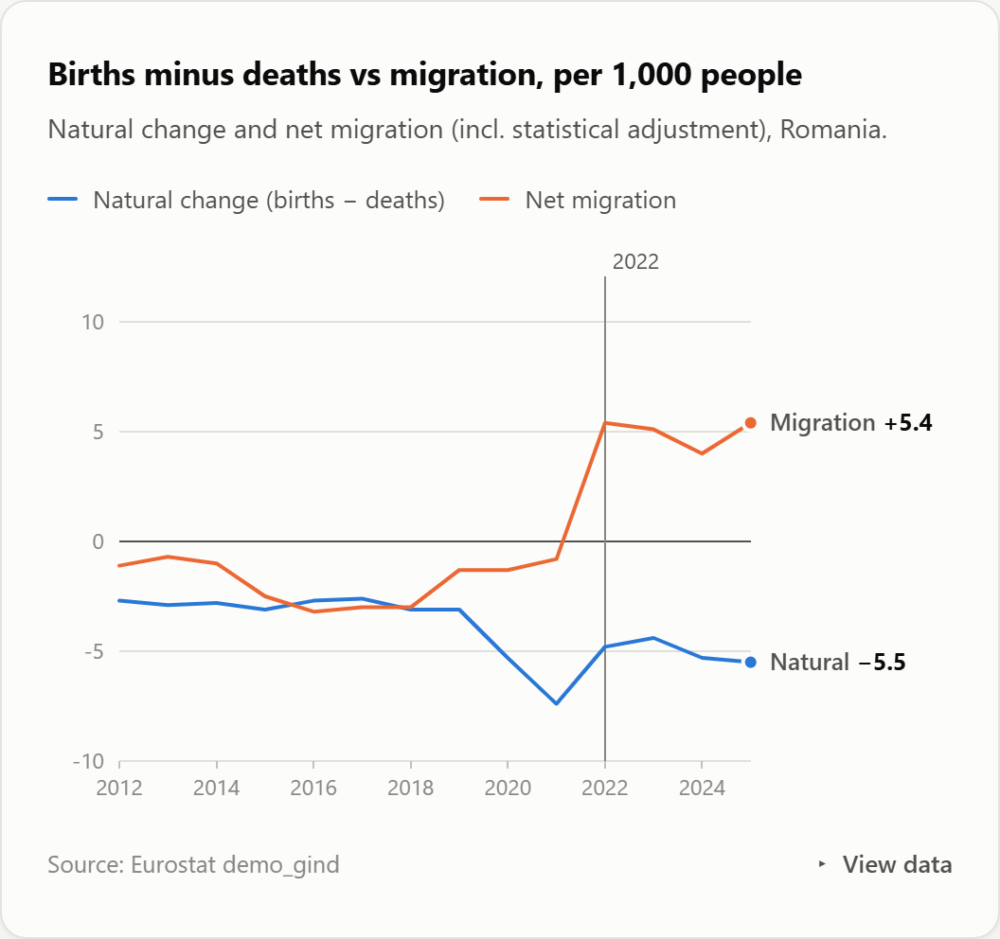

# Romania by the Numbers: where it leads Europe, where it lags, and where it is heading

**A benchmark of Romania against all 27 EU member states on 38 official indicators in seven domains (economy, society, health, education, digital & innovation, environment & energy, governance), first year of the decade vs latest. The same model ranks every EU country, and the report can switch to any of them.**

**[▶ Live interactive report](https://romania-by-the-numbers.vercel.app)** · Data: Eurostat (40 datasets, incl. the EU SDG monitoring set) · Stack: Python · DuckDB SQL · bootstrap · vanilla JS/SVG



---

## Questions

1. In which areas is Romania among the best in the EU, and in which among the worst?
2. Where has it climbed over the last decade, and where has it fallen?
3. How robust is Romania's overall position, given that any composite depends on the indicators chosen?
4. What is happening to Romania's population?

## Key findings

| | Finding | Evidence (EU rank, 1 = best) |
|---|---|---|
| 🟢 | **Strengths are physical and frugal** | GHG emissions per person **#2**, energy productivity **#2**, adult obesity **#3**, energy import dependency **#4**, gigabit broadband coverage **#5**, housing-cost burden **#7**, crime or vandalism nearby **#7** |
| ⬆️ | **Fastest climbs are in living standards** | Income inequality **#27 → #11**, housing-cost burden **#26 → #7**, crime **#20 → #7**, internet use **#27 → #17**, GDP per person (PPS) **55 → 78% of EU** (#26 → #21) |
| 🔴 | **Stuck at the bottom on human capital and the state** | Last (#27) on university degrees, basic digital skills, R&D spending, patents, online public services, infant mortality, treatable deaths, NEET youth, severe deprivation and road deaths |
| ⬇️ | **The biggest fall is in public finances** | Budget balance **#5 → #27** (−7.9% of GDP), government debt **#4 → #14**, unemployment #11 → #15, renewable share #9 → #12 |
| 📊 | **Overall: bottom three, mid-table on momentum** | Overall rank **25 / 27**. The 90% bootstrap range is **25–27**, so the result does not hinge on indicator choice. Romania ranks 13th of 27 on improvement. 7 indicators in the top third, 26 in the bottom third, 8 climbing, 7 falling. |
| 👥 | **People: fewer, older, and no longer emigrating on net** | Population **−4.5%** since 2014 (19.95m → 19.04m). Natural change worsened from −2.8 to −5.5 per 1,000. Net migration turned **positive** in 2022 (+5.4 per 1,000 in 2025). Fertility fell from 1.81 (2021) to **1.39** (2024). |

## Visuals

| 38 rankings by domain (then → now) | Quadrant: rank today vs rank change |
|---|---|
|  |  |
| **Overall score, all 27 countries** | **Domain scores, all countries** |
|  |  |
| **Six key trends vs the EU average** | **Population dynamics** |
|  |  |

## Method

```
src/catalogue.py ─► src/fetch_data.py ─► data/raw/indicators.csv (one long table, 40 Eurostat datasets)
                                                    │
                              DuckDB ─► sql/01_staging.sql ─► sql/02_marts.sql
                                         window-function ranks · comparison windows · tiers · momentum · domain & overall scores
                                                    │
                              src/build_dataset.py ─► bootstrap of the overall rank ─► report/data.json ─► report/
```

- **One catalogue drives everything.** Each indicator is a few lines: dataset, filters, unit, domain and **direction** (higher or lower is better, following the EU SDG framework). Adding an indicator means adding one entry.
- **Ranks** are computed with `rank() OVER (PARTITION BY indicator, year …)`, only in years where at least 24 of 27 countries report.
- **Comparison window:** the first ranked year from 2014, and each country's most recent ranked year.
- **Classification:**
  - top third = rank 1–9, bottom third = rank 19–27;
  - climbing or falling = moved at least 3 places.
- **Overall score** = mean of per-indicator scores `1 − (rank − 1)/(n − 1)`. Robustness is checked with 2,000 bootstrap resamples of the indicator set.

### Data quality issues found and handled

| Issue | Treatment |
|---|---|
| In Eurostat's internet-use table, `I_IUX` means **"never used the internet"**, an easy inversion | Caught by label check; the catalogue uses `I_IU3` (used in last 3 months) |
| E-government indicator redefined in 2022 (`I_IUGOV12` → `I_IUGOV1`) | Series spliced (newer definition first) and compared through **ranks**, which survive the break because all countries switched together |
| Labour Force Survey break in 2021 (education, ICT specialists) | EU-wide, so ranks stay comparable |
| Romania has no 2024 recycling figure yet, while 26 others do | Each country's latest ranked year is used, so one late reporter does not drop out |
| GHG per person has no EU-27 aggregate in Eurostat | Shown as n/a |

## Reproduce

```bash
pip install -r requirements.txt
python src/fetch_data.py         # 42 indicator queries to the Eurostat API (about 2 min)
python src/build_dataset.py      # SQL ranking models + bootstrap -> report/data.json
python -m http.server -d report  # open http://localhost:8000
```

## Limitations

- Any composite depends on the indicators chosen. The bootstrap quantifies this.
- Ranks show position, not distance. The trend charts show the underlying values.
- Directions are normative choices, made explicit in the catalogue (e.g. lower debt = better).

---

*Author: **Ionut Daniel Pop** · GitHub [@Ionutpop90](https://github.com/Ionutpop90) · Other projects: [Europe car transition](https://github.com/Ionutpop90/europe-car-transition) · [Europe health check](https://github.com/Ionutpop90/europe-health-check) · [Europe housing affordability](https://github.com/Ionutpop90/europe-housing-affordability) · [Romania vs EU inflation](https://github.com/Ionutpop90/romania-inflation-analysis)*
